# 🛰️ Decentralized Post-Quantum Adaptive UAV Swarm Framework

An advanced, peer-to-peer companion-grade **Decentralized Post-Quantum Cryptographic (PQC) and Conformal AI Intrusion Detection Framework** for Autonomous UAV Swarms.

This framework extends classical Ground Control Station (GCS) based architectures into a **Zero-Single-Point-of-Failure (Zero-SPOF) Decentralized Swarm Mesh**, where every UAV operates as an autonomous cryptographic node that mutually authenticates peers, continuously assesses peer telemetry with an ensemble AI Intrusion Detection System (IDS), and dynamically enforces post-quantum security ladders.

---

## 🚀 Key Architectural Pillars

```mermaid
graph TD
    subgraph "Decentralized UAV Swarm Mesh (Zero-SPOF)"
        UAV1["UAV Node 1 (Primary)"] <-->|"Mutual PQC Session (ML-KEM + ECC)"| UAV2["UAV Node 2 (Primary)"]
        UAV2 <-->|"Mutual PQC Session (ML-KEM + ECC)"| UAV3["UAV Node 3 (Primary)"]
        UAV3 <-->|"Mutual PQC Session (ML-KEM + ECC)"| UAV1
        
        UAVB["Backup Drone (Standby)"] -.->|"Passive Heartbeat Monitor (Eq. 4)"| UAV1
        UAVB -.->|"Passive Heartbeat Monitor (Eq. 4)"| UAV2
        UAVB -.->|"Passive Heartbeat Monitor (Eq. 4)"| UAV3
    end

    subgraph "Local Node Security Subsystems (Per UAV)"
        direction TB
        KEM["Hybrid PQC KEM<br>(ECC-P256 + Kyber-512/768/1024)"]
        HKDF["HKDF Secret Mixing<br>α = 1.0 - Trust"]
        IDS["Local AI IDS Engine<br>(XGBoost + Isolation Forest)"]
        ICP["Inductive Mondrian Conformal Prediction<br>(Error Guarantee ε = 0.05)"]
        TRUST["Decentralized Peer Trust Manager<br>(Continuous EMA Score T ∈ [0, 1])"]
        FAILOVER["Autonomous Backup Handover Engine<br>(10s Loss Timeout OR Rogue Isolation Alert)"]
    end
```



### 1. Shift from Centralized GCS to Decentralized Swarm Mesh
- **GCS Architecture Limitation**: In classical GCS networks, a central ground station acts as a single point of failure (SPOF). If jammed, attacked, or out-of-range, the entire swarm loses communication, encryption keys, and intrusion monitoring.
- **Decentralized Swarm Architecture**: Every UAV runs its own broker and mutual security engine. Peer nodes communicate directly over Tailscale, cellular LTE, or Wi-Fi ad-hoc links. No single node failure can compromise the network.

### 2. Trust-Weighted Hybrid Post-Quantum Key Exchange (ML-KEM + ECC)
- Each peer pair performs mutual key agreement combining classical **ECDH (SECP256R1)** with **CRYSTALS-Kyber KEM (ML-KEM)**:
  $$S_{\text{ECDH}} = d_A \cdot Q_B$$
  $$c_k, S_{\text{Kyber}} = \text{Kyber.Encapsulate}(pk_B^{(L)}), \quad L \in \{512, 768, 1024\}$$
  $$K_{\text{session}} = \text{HKDF-SHA256}\Big(\alpha \cdot S_{\text{ECDH}} \parallel (1 - \alpha) \cdot S_{\text{Kyber}}, \, \text{Salt}\Big), \quad \alpha = 1 - T_{\text{peer}}$$
- **Dynamic Trust Weighting ($\alpha$)**: As peer trust degrades, the key derivation dynamically shifts weight to prioritize quantum-safe Kyber.

### 3. Conformalized Ensemble AI Intrusion Detection (XGBoost + IF + Mondrian ICP)
- Telemetry frames received from peer UAVs (velocity, altitude change rate, sequence number, GPS coordinates, battery drop) are inspected locally by each UAV.
- Combines supervised **XGBoost classification** and unsupervised **Isolation Forest anomaly detection**.
- **Mondrian Conformal Prediction (ICP)** provides formal mathematically guaranteed error bounds ($\epsilon = 0.05$):
  - $S = \{Normal\}$ $\rightarrow$ Nominal status.
  - $S = \{Normal, Intruder\}$ $\rightarrow$ Ambiguous warning (escalates Kyber ladder).
  - $S = \{Intruder\}$ $\rightarrow$ Confident cyber-physical attack.
  - $S = \{\}$ $\rightarrow$ Novel zero-day outlier.

### 4. Dynamic 3-Tier Security Ladder & Cyber-Physical Rogue Node Quarantine
- **Normal Link**: ML-KEM-512 (Lightweight, ultra-fast: ~15 ms).
- **Elevated Threat**: Escalates to ML-KEM-768.
- **Critical Attack / Zero-Day**: Escalates to ML-KEM-1024.
- **Rogue Peer Isolation**: If a peer's trust drops below $T < 0.35$ or conformal prediction indicates $\{Intruder\}$, the UAV immediately revokes the peer's session key, refuses further coordinate routing, and broadcasts `ALERT_ROGUE_ISOLATED` to the swarm.

### 5. Autonomous Backup Drone Mission Handover (Sajid et al. Eq. 4 Integration)
- The **Backup Drone** listens passively to swarm heartbeats and alert broadcasts.
- **Dual Trigger Mechanisms**:
  1. **Communication Loss Timeout**: If a primary drone drops offline for $>10.0\text{ s}$, the backup drone automatically activates.
  2. **AI Intrusion Detection Quarantine**: If a primary drone is isolated as compromised, the backup drone immediately assumes its mission waypoint trajectory, preserving swarm mission continuity!

### 6. 0-RTT Session Resumption & Battery Energy Capping
- **Peer Session Tickets**: After temporary RF link dropouts, peers reconnect via 0-RTT ticket resumption, skipping asymmetric re-encapsulation.
- **Flight Energy Capping**: If battery voltage approaches critical flight cutoff ($10.20\text{ V}$) or CPU spikes above 85%, PQC rekeying is gated to ML-KEM-512 to preserve battery millijoules ($mJ$) for physical rotor lift.

---

## 📂 Directory Structure

```
decentralized_post_quantum_adaptive_framework/
│
├── models/                         # Pre-trained ML & Conformal Calibration Assets
│   ├── ids_model.pkl               # XGBoost Classifier
│   ├── ids_scaler.pkl              # StandardScaler
│   ├── ids_encoders.pkl            # Categorical Encoders
│   ├── ids_if_model.pkl            # Isolation Forest Anomaly Detector
│   ├── conformal_cal_0.pkl         # Mondrian Calibration Class 0 (Normal)
│   └── conformal_cal_1.pkl         # Mondrian Calibration Class 1 (Intruder)
│
├── key_encapsulation/              # Hybrid PQC Implementations
│   ├── crystalskyber.py            # Core NIST ML-KEM Bindings
│   ├── kyber.py                    # Kyber-512, 768, 1024 Scaling Wrappers
│   ├── ecc.py                      # SECP256R1 ECDH
│   └── hybrid_kem.py               # Trust-weighted HKDF Key Derivation
│
├── encryption/
│   └── aes_encryption.py           # Authenticated AES-256 (EAX/GCM)
│
├── ai/                             # Swarm Decentralized Security Subsystems
│   ├── peer_ids_engine.py          # Local XGBoost + IF + Conformal Prediction Engine
│   ├── peer_trust_manager.py       # Asymmetric EMA Peer Trust Tracker
│   ├── swarm_adaptive_controller.py# 3-Tier Security Ladder & Rogue Isolation Engine
│   ├── energy_manager.py           # Companion CPU Gating & Energy Savings Model
│   └── session_resumption.py       # 0-RTT Peer Session Resumption Ticket Manager
│
├── protocol.py                     # Wire Framing, Monotonic Sequencing & Anti-Replay Engine
├── broker.py                       # Zero-SPOF Local MQTT Broker Daemon
├── swarm_node.py                   # Complete Decentralized UAV Node with PQC + AI IDS
├── comm_benchmark_pqc.py           # Quantitative PQC Latency & Inference Benchmark
├── run_full_swarm_test.py          # Interactive 4-UAV Swarm Simulation Engine
│
├── attacks/                        # Swarm Attack Verification Suite
│   ├── spoof_attack.py             # Rogue Telemetry & GPS Spoofing Attack
│   ├── replay_attack.py            # Cryptographic Packet Replay Attack
│   ├── flooding_attack.py          # High-Rate DoS Telemetry Flooding
│   └── unauthorized_peer.py        # Unauthenticated Peer Injection Test
│
└── requirements.txt                # System dependencies
```

---

## 🔧 Installation & Setup

```bash
cd decentralized_post_quantum_adaptive_framework
pip install -r requirements.txt
```

---

## 🎮 Execution Guide

### Mode 0: Real-Time Tactical GUI Dashboard (Recommended)

Launch the full interactive 4-UAV Swarm GUI with live 2D GPS Radar, telemetry vision panels, and attack injection console:
```bash
python gui_dashboard.py
```
- **Live 2D GPS Radar**: Visualizes live drone positions, heading trails, and RGUKT Nuzvid campus waypoints.
- **Drone Vision Panels**: View real-time GPS, Altitude, Battery (11.52V -> 10.20V), ML-KEM PQC Security Level, and AI IDS Conformal Sets ($S=\{Normal\}$, $\{Intruder\}$, etc.).
- **Multi-Drone Attack Console**: Select **any** drone (`Drone 1`, `Drone 2`, `Drone 3`, or `Backup`) and trigger:
  - ⚡ GPS Spoofing Attack
  - 🔄 Cryptographic Replay Attack
  - 🌊 High-Rate DoS Telemetry Flood
  - 🚫 Unauthorized Rogue Peer Injection
  - 💀 Kill / Crash Drone (tests 10s silent timeout failover)
  - ♻️ Reboot / Restore Drone
  - 🚨 Manual Backup Mission Takeover

---

### Mode 1: Interactive 4-UAV Swarm Test (CLI)

Launch all 4 autonomous swarm nodes with live PQC handshakes and AI IDS in CLI mode:
```bash
python run_full_swarm_test.py
```

---

### Mode 2: Multi-Device Deployment (Physical Laptops / Raspberry Pis)

To deploy across multiple physical laptops or Raspberry Pis over Wi-Fi or Tailscale:

#### On Device 1 (Drone 1):
```bash
# Start local broker
python broker.py --host 0.0.0.0 --port 1883

# Launch Drone 1 node
python swarm_node.py --id drone_1 --role primary --peers <DEVICE_2_IP> <DEVICE_3_IP> <BACKUP_IP>
```

#### On Device 2 (Drone 2):
```bash
# Start local broker
python broker.py --host 0.0.0.0 --port 1883

# Launch Drone 2 node
python swarm_node.py --id drone_2 --role primary --peers <DEVICE_1_IP> <DEVICE_3_IP> <BACKUP_IP>
```

#### On Device 3 (Drone 3):
```bash
# Start local broker
python broker.py --host 0.0.0.0 --port 1883

# Launch Drone 3 node
python swarm_node.py --id drone_3 --role primary --peers <DEVICE_1_IP> <DEVICE_2_IP> <BACKUP_IP>
```

#### On Device 4 (Autonomous Backup Drone):
```bash
# Start local broker
python broker.py --host 0.0.0.0 --port 1883

# Launch Backup Drone node (passive monitor until failure)
python swarm_node.py --id backup_drone --role backup --peers <DEVICE_1_IP> <DEVICE_2_IP> <DEVICE_3_IP>
```

---

### Mode 3: Executing Attack Validation Experiments

With the swarm running, execute any of the standalone attack scripts from another terminal:

1. **GPS & Telemetry Spoofing Attack**:
   ```bash
   python attacks/spoof_attack.py --broker 127.0.0.1 --attacker-id drone_2 --count 15
   ```
2. **Cryptographic Replay Attack**:
   ```bash
   python attacks/replay_attack.py --broker 127.0.0.1 --target-drone drone_1
   ```
3. **High-Rate DoS Flooding Attack**:
   ```bash
   python attacks/flooding_attack.py --broker 127.0.0.1 --target-drone drone_1 --count 300
   ```
4. **Unauthorized / Unauthenticated Node Injection**:
   ```bash
   python attacks/unauthorized_peer.py --broker 127.0.0.1 --fake-id fake_drone_99
   ```

---

### Mode 4: Quantitative Performance Benchmarking

Benchmark the hybrid cryptographic tiers and local AI IDS algorithmic latency:
```bash
python comm_benchmark_pqc.py --trials 15
```

**Empirical Measured Latencies:**
- **ML-KEM-512 + ECC-P256**: ~15–19 ms
- **ML-KEM-768 + ECC-P256**: ~21–22 ms
- **ML-KEM-1024 + ECC-P256**: ~29–31 ms
- **AI IDS Inference Latency**: ~13–14 ms
